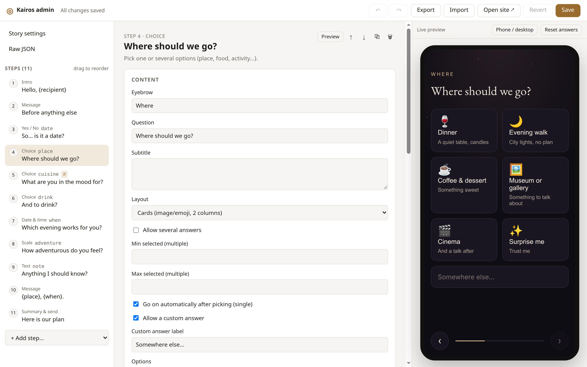

# Kairos-Genesis (Καιρός – Γένεσις)

> *Some moments are meant to become beginnings.*

A base for a small, personal website made for a first date. The person you send it to goes through a few elegant steps (*is it a date? where should we go? which evening? anything I should know?*), and the answers come back to you as a ready plan.

Every step is a module, and the whole story is one JSON file that you edit in a built-in admin with a live preview. Fork it, make it yours, send the link.



## The name

- **Kairos (καιρός)** – the opportune moment, when circumstances align and something meaningful happens.
- **Genesis (γένεσις)** – origin, birth, the beginning of something new.

Together: *the birth of something meaningful at the right moment.* The site should feel sincere, curious, elegant, warm and a little mysterious – a small world made for one particular person, not a landing page.

## Quick start

With Docker:

```bash
docker compose up dev      # site: http://localhost:5173  admin: http://localhost:5173/admin.html
docker compose up site     # production build on http://localhost:8080 (no admin)
```

Or with Node 24+:

```bash
npm install
npm run dev                # same URLs as above
npm run build              # static site in dist/
```

## Making it yours

1. Open **`/admin.html`** while the dev server runs.
2. **Story settings**: names (`{recipient}`, `{author}` and any other placeholders), theme colors (or one of the presets), fonts, particles, and where the answers should go.
3. **Steps**: add, reorder (drag), duplicate, delete. Every field of every step is editable, including conditions (*show only if…*) and per-step appearance (background image, accent color, CSS class).
4. **Save** (`Ctrl+S`) writes `src/story.json`. Uploaded images go to `public/media/`.
5. Commit and deploy.

The admin exists only on the dev server. It is not part of the production build, so the person you send the link to can never open it.

### Step types

| Type | What it does | Stores |
| --- | --- | --- |
| `intro` | Opening screen with a big title and a begin button | – |
| `message` | A letter or a quote; can show earlier answers (`{place}`) | – |
| `choice` | Pick one or several options: cards, grid or list, emoji or images, custom answer | `string` / `string[]` |
| `scale` | A slider with a word per value | `number` |
| `text` | Free text, short or multi-line | `string` |
| `date` | Offered days (or a free picker) plus times | `"YYYY-MM-DD[THH:MM]"` |
| `confirm` | Yes / no, the "no" can playfully run away | `boolean` |
| `summary` | Recap of all answers and ways to send them back | – |

### Conditions

A step with `when` is shown only if all of its conditions hold. Hidden steps are skipped and left out of the recap:

```json
{ "type": "choice", "id": "cuisine", "when": [{ "id": "place", "op": "equals", "value": "dinner" }] }
```

Operators: `equals`, `notEquals`, `includes`, `excludes`, `answered`, `gte`, `lte`.

### Getting the answers back

Configured under **Story settings → Getting the answers back** (`submit` in `story.json`). Any combination works:

- **POST endpoint** – answers are sent as JSON to e.g. [Formspree](https://formspree.io), a Cloudflare Worker or a Google Apps Script.
- **Telegram** – the recap is copied to the clipboard and your chat opens.
- **WhatsApp / email** – opens with the recap prefilled.
- **Copy / share** – the native share sheet on phones, the clipboard elsewhere.

## Deploying

- **GitHub Pages**: `.github/workflows/pages.yml` deploys `main` automatically (enable *Settings → Pages → Source: GitHub Actions*).
- **Any static host** (Netlify, Cloudflare Pages, Vercel): upload `dist/`.
- **Your own server**: `docker compose up -d site`, or pull the prebuilt image:

  ```bash
  docker run -d -p 8080:80 --restart unless-stopped severnbli/kairos-genesis:latest
  ```

  `.github/workflows/docker.yml` builds a multi-arch image (amd64, arm64) and pushes it to Docker Hub: `:latest` from `main`, `:dev` from `dev`, `:1.2.3` from `v1.2.3` tags. It needs the repo secrets `DOCKERHUB_USERNAME` and `DOCKERHUB_TOKEN`; forks change `IMAGE` in the workflow.

The build uses relative paths, so it works from any sub-path.

### Privacy

Your story is personal. A fork of a public repository is public too, so consider **Use this template** → private repository instead. The page sends `noindex` so search engines skip it, but anyone with the link can open it. The Docker image contains your whole story, so make the Docker Hub repository private too.

## Adding a new step type

Create `src/steps/<name>/index.ts` (+ `style.css`), export a `defineStep({...})` with `label`, `description`, `fields`, `create` and `mount`, and register it in `src/steps/index.ts`. The admin builds the editor for it from `fields`. See [CLAUDE.md](CLAUDE.md) for details.

## License

[MIT](LICENSE)
